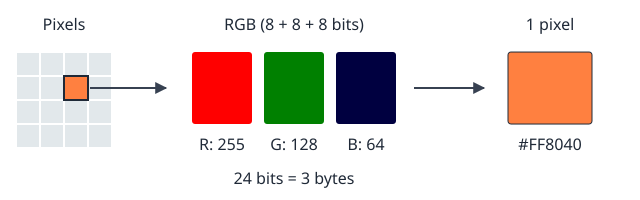
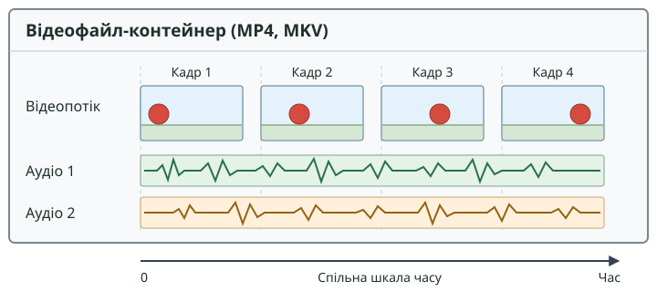

::: {.callout-caution}
Чернетка конспекту.
Матеріал буде змінюватися.
:::

## Про що лекція

Комп'ютер працює лише з нулями та одиницями.
Усе інше — числа, текст, картинки, звук — це домовленості про те, як записати світ у вигляді цих двох символів.
Ми розберемо, як влаштовані ці домовленості.

Після лекції ви зможете:

- пояснити, що таке біт і байт;
- перевести невелике число в двійкову систему й назад;
- пояснити, чому текст потребує кодування і чим Unicode відрізняється від ASCII;
- розрізняти текстові й бінарні файли;
- здогадуватися, чому комп'ютер іноді помиляється в дробових числах.

Після лекції виконайте [Завдання 1: Кодування даних](../assignments/01-data-encoding-hw.qmd).

## Історія двох станів

### Біт - найменша одиниця інформації {#bit}

Найпростіше, що може запам'ятати електронна схема, — це «є сигнал» або «немає сигналу».
Ці два стани домовилися позначати як **1** («так») і **0** («ні»).
Один такий символ називається **бітом**.

Біт один не каже багато.
Але кілька бітів разом уже можуть описати багато різних значень.
Один біт має два можливі стани: `0` і `1`.
Два біти утворюють чотири комбінації: `00`, `01`, `10` і `11`.
З кожним новим бітом кількість значень подвоюється.

| Кількість бітів | Степінь двійки                   | Скільки різних значень |
|----------------:|:--------------------------------:|-----------------------:|
|               1 | $2$                              |                      2 |
|               2 | $2 \cdot 2$                      |                      4 |
|               3 | $2 \cdot 2 \cdot 2$              |                      8 |
|               4 | $2 \cdot 2 \cdot 2 \cdot 2$      |                     16 |
|               8 | $2^8$                            |                    256 |
|              10 | $2^{10}$                         |                   1024 |
|              16 | $2^{16}$                         |                  65536 |
|              32 | $2^{32}$                         |             4294967296 |
|              64 | $2^{64}$                         |   18446744073709551616 |

: Кількість різних значень, які можна закодувати заданою кількістю бітів. {#tbl-bit-counts}

::: {.callout-tip title="Пояснення: $2^n$ станів для $n$ бітів"}

Позначимо через $k_n$ кількість бітових рядків довжини $n$, тобто кількість значень, які можна закодувати $n$ бітами.
Рядок із $n+1$ бітів починається або з 0, або з 1.
Після першого біта в обох випадках залишаються $n$ позицій, які можна заповнити будь-яким із $k_n$ рядків.
Отже, рядки розбиваються на дві неперетинні групи по $k_n$ у кожній.

$$
\begin{array}{c}
\overbrace{\boxed{\bullet}\underbrace{\boxed{\bullet\;\bullet\;\cdots\;\bullet}}_{n\text{ біт}}}^{(n+1)\text{ біт}} \quad k_{n+1}
\\[0.6em]
\swarrow \qquad \searrow
\\[0.6em]
\boxed{\texttt{0}}\overbrace{\boxed{\bullet\;\bullet\;\cdots\;\bullet}}^{n\text{ біт}} \quad k_n
\qquad
\boxed{\texttt{1}}\overbrace{\boxed{\bullet\;\bullet\;\cdots\;\bullet}}^{n\text{ біт}} \quad k_n
\end{array}
$$

Таким чином:
$$
k_1 = 2, \; k_{n+1} = k_n + k_n = 2 k_n \implies k_n = 2^n
$$

Для одного біта є два можливі рядки: `0` і `1`, тому $k_1=2$.
Кожен доданий біт подвоює кількість рядків, тож для $n$ бітів маємо $k_n=2^n$.

:::

:::: {.callout-note title="Самоперевірка" collapse="true"}

Скількох бітів достатньо, щоб пронумерувати всі атоми у спостережуваному Всесвіті?

::: {.callout-tip collapse="false" title="Підказка 1"}
[Число Еддінгтона](https://en.wikipedia.org/wiki/Eddington_number) оцінює кількість протонів у спостережуваному Всесвіті як приблизно $10^{80}$.
:::

::: {.callout-tip collapse="true" title="Підказка 2"}
Спочатку дайте відповідь на запитання: скільки бітів потрібно, щоб закодувати 10 значень?
:::

::: {.callout-tip collapse="true" title="Підказка 3"}
Скористайтеся таблицею вище й подумайте: чи можете ви зменшити свою початкову оцінку?
:::

::::

### Байт і більші обсяги даних {#byte-and-data-magnitudes}

Вісім бітів утворюють **байт**.
Байт може зберігати 256 різних значень.
Це не дуже багато, але достатньо, наприклад, для зберігання одного символу тексту.
Більші обсяги даних вимірюють кілобайтами, мегабайтами, гігабайтами, терабайтами, петабайтами, ексабайтами.
Усе це — типові порядки величин для обсягів даних у світі інформації. Але "кілобайт" — скільки це байтів? Ми знаємо, що 1 км дорівнює 1000 метрів, 1 кг дорівнює 1000 грамів, але для байтів, на диво, відповідь така: "це залежить...".

::: {.callout-tip collapse="true" title="Показати ілюстрацію експоненційної зміни порядків величин"}

Порядки величин допомагають нам осмислити величини, які значно відрізняються одна від одної. [^orders-of-magnitude-data]
Вони змінюються експоненційно. Наступна ілюстрація показує наскільки швидкою є експоненційна зміна на прикладі зміни [довжини][orders-of-magnitude-length] об'єктів при переході від одного до іншого порядку величини.

::: {.content-visible when-format="html"}
<figure id="fig-orders-of-magnitude" class="figure">
    
    <figcaption class="figure-caption">Об'єкти у різних порядках величини: від субатомних масштабів до спостережуваного Всесвіту.</figcaption>
</figure>
:::

::: {.content-visible unless-format="html"}
[Відкрити ілюстрацію на Wikimedia Commons](https://commons.wikimedia.org/wiki/File:Orders_of_magnitude_(english_annotations).png).
:::

Джерело ілюстрації: [^orders-of-magnitude-image]

:::

[^orders-of-magnitude-image]: Ілюстрацію створив Pablo Carlos Budassi; джерело: [Wikimedia Commons](https://commons.wikimedia.org/wiki/File:Orders_of_magnitude_(english_annotations).png); ліцензія: [CC BY-SA 4.0](https://creativecommons.org/licenses/by-sa/4.0/). Зображення повернуто на 90° за годинниковою стрілкою. Докладніше про поняття — у статті [«Порядок величини» в українській Вікіпедії](https://uk.wikipedia.org/wiki/%D0%9F%D0%BE%D1%80%D1%8F%D0%B4%D0%BE%D0%BA_%D0%B2%D0%B5%D0%BB%D0%B8%D1%87%D0%B8%D0%BD%D0%B8).[^orders-of-magnitude-data]

[^orders-of-magnitude-data]: Приклади порядків величини для обсягів даних наведено в англомовній статті [«Orders of magnitude (data)»](https://en.wikipedia.org/wiki/Orders_of_magnitude_(data)).

Все залежить від того, чи використовуємо ми десяткові префікси (1 kB = 1000 байтів) чи двійкові (KiB = KB = 1024 байти).
У десятковій системі кожна наступна одиниця у 1000 разів більша: 1 kB = 1000 байтів, а 1 MB = 1000 kB.
Для степенів двійки використовують окремі назви: 1 KiB = 1024 байти, а 1 MiB = 1024 KiB.
Тому позначення KB іноді неоднозначне: воно може означати і 1000, і 1024 байти ([докладніше про кілобайт](https://uk.wikipedia.org/wiki/Кілобайт)).

| Десяткова кількість байтів | Позначення [SI] | Двійкова кількість байтів | Позначення [МЕК (IEC)][IEC] | Позначення [JEDEC] |
| ---------------------------: | :-------------: | --------------------------: | :--------------: | :----------------: |
| $1$ | B ([байт]) | $1$ | B (байт) | B |
| $10^3$ | kB ([кілобайт]) | $2^{10}$ | KiB ([кібібайт]) | KB (кілобайт) |
| $10^6$ | MB ([мегабайт]) | $2^{20}$ | MiB ([мебібайт]) | MB (мегабайт) |
| $10^9$ | GB ([гігабайт]) | $2^{30}$ | GiB ([гібібайт]) | GB (гігабайт) |
| $10^{12}$ | TB ([терабайт]) | $2^{40}$ | TiB ([тебібайт]) | TB (терабайт) |
| $10^{15}$ | PB ([петабайт]) | $2^{50}$ | PiB ([пебібайт]) | — |
| $10^{18}$ | EB ([ексабайт]) | $2^{60}$ | EiB ([ексбібайт]) | — |

: Порівняння десяткових і двійкових префіксів байта. {#tbl-byte-units}

[SI]: https://uk.wikipedia.org/wiki/Міжнародна_система_одиниць_%28SI%29
[orders-of-magnitude-length]: https://uk.wikipedia.org/wiki/Порядки_величин_%28довжина%29
[IEC]: https://uk.wikipedia.org/wiki/Міжнародна_електротехнічна_комісія
[JEDEC]: https://uk.wikipedia.org/wiki/JEDEC
[байт]: https://uk.wikipedia.org/wiki/Байт
[кілобайт]: https://uk.wikipedia.org/wiki/Кілобайт
[кібібайт]: https://uk.wikipedia.org/wiki/Кібібайт
[мегабайт]: https://uk.wikipedia.org/wiki/Мегабайт
[мебібайт]: https://uk.wikipedia.org/wiki/Мебібайт
[гігабайт]: https://uk.wikipedia.org/wiki/Гігабайт
[гібібайт]: https://uk.wikipedia.org/wiki/Гібібайт
[терабайт]: https://uk.wikipedia.org/wiki/Терабайт
[тебібайт]: https://uk.wikipedia.org/wiki/Тебібайт
[петабайт]: https://uk.wikipedia.org/wiki/Петабайт
[пебібайт]: https://uk.wikipedia.org/wiki/Байт#Префікси
[ексабайт]: https://uk.wikipedia.org/wiki/Ексабайт
[ексбібайт]: https://uk.wikipedia.org/wiki/Ексбібайт

:::: {.callout-note title="Самоперевірка" collapse="true"}

1. Який кілобайт більший: kB чи KB (KiB) — і на скільки байтів?
2. А яка різниця в байтах між десятковими та двійковими терабайтами? Скільки ця різниця становить в GB і GiB?

::: {.callout-tip collapse="true" title="Підказка"}
Скористайтеся таблицею зі ступенями двійки (@tbl-bit-counts).
:::

::::

## Цілі числа

### Позиційні системи числення

<!-- Символи для запису чисел -->
Люди в різних культурах використовують різні символи для запису чисел (@tbl-numeral-symbols).Однакові значення можна записати різними символами, але правила утворення багатозначних чисел у цих системах теж відрізняються.

| Запис | 0 | 1 | 2 | 3 | 4 | 5 | 6 | 7 | 8 | 9 |
| :--- | :---: | :---: | :---: | :---: | :---: | :---: | :---: | :---: | :---: | :---: |
| [Брайль (нижні цифри)][^lower-braille] | ⠴ | ⠂ | ⠆ | ⠒ | ⠲ | ⠢ | ⠖ | ⠶ | ⠦ | ⠔ |
| [Звичні нам арабські цифри] | 0 | 1 | 2 | 3 | 4 | 5 | 6 | 7 | 8 | 9 |
| [Деванагарі] | ० | १ | २ | ३ | ४ | ५ | ६ | ७ | ८ | ९ |
| [Арабсько-індійські цифри] | ٠ | ١ | ٢ | ٣ | ٤ | ٥ | ٦ | ٧ | ٨ | ٩ |
| [Китайські ієрогліфи] | 〇 | 一 | 二 | 三 | 四 | 五 | 六 | 七 | 八 | 九 |
| [Формальні ієрогліфи][^formal-numerals] | 零 | 壹 | 贰 | 参 | 肆 | 伍 | 陆 | 柒 | 捌 | 玖 |
| [Римські числа] | —[^roman-zero] | I | II | III | IV | V | VI | VII | VIII | IX |

: Символи для значень від 0 до 9 у різних системах запису.[^numeral-source] {#tbl-numeral-symbols tbl-colwidths="[30,7,7,7,7,7,7,7,7,7,7]"}

[Брайль (нижні цифри)]: https://uk.wikipedia.org/wiki/Шрифт_Брайля
[Звичні нам арабські цифри]: https://uk.wikipedia.org/wiki/Арабські_цифри
[Деванагарі]: https://uk.wikipedia.org/wiki/Деванагарі
[Арабсько-індійські цифри]: https://en.wikipedia.org/wiki/Eastern_Arabic_numerals
[Китайські ієрогліфи]: https://en.wikipedia.org/wiki/Chinese_numerals
[Формальні ієрогліфи]: https://en.wikipedia.org/wiki/Chinese_numerals
[Римські числа]: https://uk.wikipedia.org/wiki/Римські_цифри

[^lower-braille]: Нижні цифри Брайля використовують у певних системах запису, зокрема математичних; це не звичайний текстовий запис цифр Брайлем.

[^formal-numerals]: Наведено варіанти формальних ієрогліфів з ілюстрації-джерела.

[^roman-zero]: Риска означає відсутність символу для нуля, а не запис нуля.

[^numeral-source]: Символи відтворено з [ілюстрації «Numeral Systems of the World» на Wikimedia Commons](https://commons.wikimedia.org/wiki/File:Numeral_Systems_of_the_World.svg).

::: {.callout-tip title="Додаткове читання"}
Більше історичних прикладів і пояснень до систем числення наведено у статті Миколи Григорчука «Символіка систем числення» [@hryhorchuk-2021-symbolika-system-chyslennia].
:::

Розглянемо систему числення, яку ми використовуємо в повсякденному житті — десяткову систему.
У десятковій системі позиція цифри визначає її вагу. Така система називається позиційною системою числення. Наприклад:

$$
\mathtt{2026}_{10} = 2 \cdot 10^3 + 0 \cdot 10^2 + 2 \cdot 10^1 + 6 \cdot 10^0
$$

Комп'ютери також використовують позиційну систему числення, але в основі двійкова система, де є лише дві цифри: `0` і `1`.
Двійковий запис працює так само, як десятковий, але розряди рахують степенями двійки:

$$
\mathtt{101}_{2} = 1 \cdot 2^2 + 0 \cdot 2^1 + 1 \cdot 2^0 = 1 \cdot 4 + 0 \cdot 2 + 1 \cdot 1 = \mathtt{5}_{10}
$$

У програмуванні часто використовують шістнадцяткову систему числення з основою 16.
У шістнадцятковій системі нам потрібно 16 цифр. Недостачу цифр від 10 до 15 позначають літерами `A`, `B`, `C`, `D`, `E` та `F`.
Наприклад, рік $\mathtt{2026}_{10}$ у десятковій системі записується як $\mathtt{7EA}_{16}$ у шістнадцятковій:

$$
\mathtt{2026}_{10} = 16^2 \cdot 7 + 16^1 \cdot 14 + 16^0 \cdot 10 = \mathtt{7EA}_{16}
$$

Ця система зручна тим, що кожна шістнадцяткова цифра відповідає чотирьом бітам, тому двійковий запис легко перетворити, об'єднавши біти в групи по чотири.

:::: {.callout-note title="Самоперевірка" collapse="true" }

Який зараз рік у двійковій системі числення?

::: {.callout-tip title="Підказка" collapse="true" }
Переведіть поточний рік у шістнадцяткову систему, а потім замініть кожну шістнадцяткову цифру відповідним блоком із чотирьох бітів.
:::

::::

Так виглядає лічба від 0 до 15 чотирма бітами:

::: {.content-visible when-format="html"}

:::

::: {.content-visible unless-format="html"}

:::

У Python двійковий запис числа можна побачити наступним чином:

```{python}
#| echo: true
print(format(2026, "b"))  # 111111001010
print(int("111111001010", 2))  # 2026
```

А шістнадцятковий запис відповідно так:

```{python}
#| echo: true
print(format(2026, "X"))  # 7EA
print(int("7EA", 16))  # 2026
```

::: {.callout-tip title="Пісочниця для дослідження двійкового лічильника"}
У [зошиті «Двійковий лічильник»](https://molab.marimo.io/github/SGo-Go/cs00/blob/main/assets/lecture01/notebooks/binary_counter.py/wasm) дослідіть біти, розрядні ваги та подання числа у двійковій, вісімковій і шістнадцятковій системах.
:::

### Невід'ємні цілі числа в комп'ютері

*Невід'ємних цілих чисел* (або так званих *чисел без знаку*) нескінченно багато: $0, 1, 2, \ldots$.
Щоб кодувати будь-яке з них бітовим рядком фіксованої довжини, знадобилося б нескінченно багато бітів.
Проте на практиці для числа виділяють скінченну кількість бітів, обмежену типом даних або доступною пам'яттю.
Поширені розрядності машинних типів — 8, 16, 32 і 64 біти.
Наприклад, вісім бітів утворюють байт, який може зберігати числа від 0 до 255.

Це суттєво впливає на арифметичні операції: у 8-бітовому беззнаковому типі при додаванні або множенні чисел ми не можемо отримати результат, більший за 255. Якщо ж виходить більше значення, старші біти відкидаються.

$$
\begin{array}{r}
\mathtt{\phantom{0}\boxed{1000'0000}_2}\\
\underline{+\mathtt{\phantom{0}\boxed{1000'0000}}_2}\\
\mathtt{1'\boxed{0000'0000}_2}
\end{array}
$$

::: {.callout-caution title="Переповнення (overflow)"}
Переповнення виникає, коли точний результат арифметичної операції виходить за межі значень, які можна подати заданою кількістю бітів.
Через це збережене значення може відрізнятися від математичного результату.
:::

Ситуацію беззнакового переповнення зручно розуміти як арифметику за модулем $2^n$: бітовий рядок зберігає остачу від ділення результату на $2^n$.
В арифметиці за модулем $2^n$ результат завжди обмежений $n$ бітами, і числа, що мають однаковий залишок за модулем $2^n$, належать до одного класу лишків.
Наприклад, у 8 бітах $0\equiv 256\equiv 512\equiv\ldots\pmod{256}$, і всі ці числа належать до одного класу лишків, тобто комп'ютер їх розрізняти не буде, якщо ми працюємо з 8-бітовими числами в пам'яті.
Порівняння за одним і тим самим модулем можна додавати, віднімати й множити. [^modular-comparison-operations]
Але варто пам'ятати, що результат арифметичних операцій за модулем дає клас лишків, а не саме число.
Візуально це можна уявити як коло класів лишків, отримане "закручуванням" інтервалів числової прямої довжиною $2^n$, де числа з одного класу розташовані на однакових позиціях на колі.

:::: {.callout-note title="Самоперевірка" collapse="true" }

Модульну арифметику часто використовують для опису циклічних процесів. Які циклічні процеси та вимірювальні прилади з повсякденного життя ви можете навести? За яким модулем працює кожен із них?

::: {.callout-tip title="Підказка" collapse="true" }

Візьмімо за приклад обертання Землі навколо своєї осі. Повний оберт — це одна доба (інтервал числової прямої).

:::

::::

[^modular-comparison-operations]: [§ 2 «Порівняння» у Курранта й Роббінса](../assets/courant-robbins-1941-translation-ua/courant-robbins-ch1-1941-translation-ua.qmd#number-comparisons).

::: {.content-visible when-format="html"}

:::

::: {.content-visible unless-format="html"}

:::

```{python}
#| label: fig-modular-integers
#| fig-cap: 'Класи лишків за різних модулів.'
#| echo: false
#| fig-alt: "Інтерактивне коло класів лишків. Повзунок змінює модуль від 2 до 256 (повний байт), початкове значення — 16."

%run ../scripts/modular_residues.py
from IPython.display import HTML, display

figure = create_modular_residue_figure(repr_min=-2, repr_max=3)

display(HTML(figure.to_html(full_html=False, include_plotlyjs="cdn", include_mathjax=False)))
```

::: {.callout-note title="Самоперевірка" collapse="true"}

1. Яке найбільше беззнакове число можна подати за допомогою $n$ бітів?
2. Як це число записати у шістнадцятковій системі, якщо $n=32$?

:::

### Від'ємні числа {#twos-complement}

Ми знаємо, що числа можуть бути від’ємними. Як можна їх подати? Найпростіший спосіб — відвести один біт для знака, а решту — для модуля числа. Тоді у 8-бітному поданні 5 записується як $\boxed{\mathtt{0000'0101}}$, а −5 — як $\boxed{\mathtt{1000'0101}}$. Однак цей спосіб має кілька недоліків. Наприклад, як у ньому подати нуль?

Для подолання цих недоліків від'ємнi числа часто у представленні з використанням так званого **доповнення до двійки**. Якщо число додатне, його двійкове представлення залишається таким самим, як у беззнаковому випадку. Якщо число від’ємне, його подають як додатне число, що дорівнює $2^n$ мінус модуль числа, тобто $-x \equiv 2^n - |x| \pmod{2^n}$ найближчим додатним числом з того ж класу лишків.
Наприклад, у 8-бітовому представленні:

- $\mathtt{5}_{10} \equiv \mathtt{00000101}_{2}$
- $\mathtt{-5}_{10} \equiv 2^8 - 5 \equiv \mathtt{11111011}_{2}$ (доповнення до двійки)

Це дозволяє виконувати віднімання так само, як додавання, без додаткових схем.

:::: {.callout-note title="Самоперевірка" collapse="true"}

1. У доповненні до двійки більше додатних чи від'ємних значень? Нуль не рахуємо.
2. Якому числу відповідає $\mathtt{FFFF}_{16}$ в 16-бітовому доповненні до двійки?
    А в 32-бітовому доповненні до двійки?

::: {.callout-tip title="Підказка" collapse="true"}

$\mathtt{FFFF}_{16} = \mathtt{10000}_{16} - 1 = 2^{16} - 1$.

:::

::::

:::: {.callout-note title="Самоперевірка" collapse="true"}

Дослідіть переповнення при роботі із числами в доповненні до двійки.
Коли виникає переповнення? Як поводяться старші біти?

::::

На рисунку @fig-integer-axis показано класи лишків на числовій осі для різної розрядності та відповідні беззнакові й знакові подання.
Повзунок змінює розрядність від 2 до 8 бітів; початкове значення — 4 біти.
Наведіть курсор на число, щоб виділити всі числа того самого класу лишків в обох поданнях.

```{python}
#| label: fig-integer-axis
#| fig-cap: 'Беззнакове та знакове подання чисел для вибраної розрядності.'
#| echo: false
#| fig-alt: "Два числові ряди показують беззнакове подання та доповнення до двійки. Повзунок змінює розрядність від 2 до 8 бітів; наведення на число підсвічує числа того самого класу лишків."

%run ../scripts/modular_residues.py
from IPython.display import HTML, display

figure = create_integer_axis_figure()
display(HTML(figure.to_html(
  full_html=False,
  include_plotlyjs="cdn",
  include_mathjax=False,
  post_script=INTEGER_AXIS_HOVER_SCRIPT,
)))
```

### Типи даних

Сам по собі бітовий запис не визначає значення: його тлумачення залежить від типу даних. Для цілого числа важливо знати, чи є тип знаковим, і скільки бітів у ньому відведено для числа.

::: {.callout-tip title="Приклад" collapse="true"}

$\mathtt{FF}_{16}$ — це 255 для 8-бітового беззнакового типу, але −1 для 8-бітового знакового типу в доповненні до двійки.
Під час розширення знакового числа до 16 бітів знак зберігають, доповнюючи запис одиницями: $\mathtt{FFFF}_{16}$ — це −1. Якщо ж доповнити запис нулями, $\mathtt{00FF}_{16}$ означатиме 255.

:::

Вбудований тип `int` у Python має *довільну точність*, тому не має фіксованої розрядності: число зростає за потреби, поки вистачає пам'яті. Для значень фіксованої розрядності використовують, наприклад такі типи NumPy:

| Тип NumPy | Розрядність | Діапазон значень |
| :--- | ---: | :--- |
| `numpy.int8` | 8 бітів | $-2^7$ … $2^7 - 1$ |
| `numpy.uint8` | 8 бітів | $0$ … $2^8 - 1$ |
| `numpy.int16` | 16 бітів | $-2^{15}$ … $2^{15} - 1$ |
| `numpy.uint16` | 16 бітів | $0$ … $2^{16} - 1$ |
| `numpy.int32` | 32 біти | $-2^{31}$ … $2^{31} - 1$ |
| `numpy.uint32` | 32 біти | $0$ … $2^{32} - 1$ |
| `numpy.int64` | 64 біти | $-2^{63}$ … $2^{63} - 1$ |
| `numpy.uint64` | 64 біти | $0$ … $2^{64} - 1$ |

: Типи цілих чисел NumPy за розрядністю та діапазоном значень. {#tbl-numpy-integer-types}

Назва кожного такого типу NumPy складається з трьох частин:

1. префікс `u` (unsigned), наявний у випадки беззнакових типів, відсутній у знакових,
2. основа `int` (integer), що позначає ціле число, і
3. розрядність (кількість бітів).

$$
\begin{array}{c@{\quad}c@{\quad}c}
\mathtt{u} & \mathtt{int} & \mathtt{64} \\
\downarrow & \downarrow & \downarrow \\
 \text{unsigned (беззнакове)} & \text{integer (ціле число)} & \text{64 біти}
\end{array}
$$

Змінити тип числа можна за допомогою методів `astype` у NumPy. Наприклад:

```{python}
#| echo: true
import numpy

num16 = numpy.uint16(int("FF", 16))
print(f"0x{num16:04X} -> uint8: {num16.astype(numpy.uint8)} int8: {num16.astype(numpy.int8)}")
```

## Текст — це цілі числа

Комп'ютер не знає літер.
Він зберігає числа, а люди домовилися, якій літері відповідає яке число. Найчастіше використовують на практиці ASCII та Unicode.

[**ASCII**](https://uk.wikipedia.org/wiki/ASCII) — стара таблиця на 128 символів: англійські літери, цифри та знаки.

У таблиці рядок і стовпець разом утворюють шістнадцятковий код символу. `SP` позначає пробіл, а назви на кшталт `LF` і `CR` — керівні коди.
Позначки: *курсивом* показано символи, змінені або додані у версії 1963 року; **жирним шрифтом** — символи, змінені у версії 1963 року та в проєкті 1965 року.

| | 0 | 1 | 2 | 3 | 4 | 5 | 6 | 7 | 8 | 9 | A | B | C | D | E | F |
| --- | --- | --- | --- | --- | --- | --- | --- | --- | --- | --- | --- | --- | --- | --- | --- | --- |
| 0x | NUL | *SOH* | *STX* | *ETX* | EOT | *ENQ* | *ACK* | BEL | *BS* | HT | LF | VT | FF | CR | SO | SI |
| 1x | *DLE* | DC1 | DC2 | DC3 | DC4 | *NAK* | SYN | *ETB* | *CAN* | *EM* | **SUB** | *ESC* | *FS* | *GS* | *RS* | *US* |
| 2x | SP | ! | " | # | $ | % | & | ' | ( | ) | * | + | , | - | . | / |
| 3x | 0 | 1 | 2 | 3 | 4 | 5 | 6 | 7 | 8 | 9 | : | ; | < | = | > | ? |
| 4x | **&#64;** | A | B | C | D | E | F | G | H | I | J | K | L | M | N | O |
| 5x | P | Q | R | S | T | U | V | W | X | Y | Z | [ | **&#92;** | ] | *^* | *&#95;* |
| 6x | **&#96;** | *a* | *b* | *c* | *d* | *e* | *f* | *g* | *h* | *i* | *j* | *k* | *l* | *m* | *n* | *o* |
| 7x | *p* | *q* | *r* | *s* | *t* | *u* | *v* | *w* | *x* | *y* | *z* | *{* | **&#124;** | *}* | **~** | DEL |

: 7-бітова таблиця ASCII, згрупована за шістнадцятковим кодом. За зразком [таблиці набору символів у Вікіпедії](https://en.wikipedia.org/wiki/ASCII#Character_set). {#tbl-ascii}

[**Unicode**](https://uk.wikipedia.org/wiki/Unicode) — велика таблиця, що містить символи майже всіх мов, а також емодзі. [**UTF-8**](https://uk.wikipedia.org/wiki/UTF-8) — спосіб записати символи Unicode в байтах, суміснyj з 8-бітовим кодуванням тексту.

Деякі видимі символи Unicode нагадують складні китайські ієрогліфи: на екрані вони виглядають як один знак, але можуть складатися з кількох кодових точок.

::: {.callout-tip title="Приклад складеного ієрогліфа" collapse="true"}

Розіберемо поширений ієрогліф **男** (*nán*, «чоловік»):

1. Він графічно складається з **田** («поле») та **力** («сила»).
2. За традиційним мнемонічним поясненням, чоловік обробляв поле, використовуючи фізичну силу.
<!-- 3. Ці частини допомагають запам'ятати форму й значення, але 男 — один знак Unicode, кодова точка U+7537. -->

Додаткові приклади таких мнемонічних пояснень:

| Ієрогліф і піньїнь | Значення | Компоненти | Мнемонічне пояснення |
| :--- | :--- | :--- | :--- |
| **明** *míng* | Яскравий | **日** (сонце) + **月** (місяць) | Поєднання двох найяскравіших небесних світил передає яскравість. |
| **休** *xiū* | Відпочивати | **亻** (людина) + **木** (дерево) | Людина, що спирається на стовбур дерева, відпочиває. |
| **林** *lín* | Гай, лісок | **木** (дерево) + **木** (дерево) | Два дерева поруч утворюють невеликий гай. |
| **森** *sēn* | Хащі, густий ліс | **木** + **木** + **木** (дерево) | Три дерева разом передають образ густого лісу. |
| **从** *cóng* | Іти слідом | **人** (людина) + **人** (людина) | Одна людина йде безпосередньо за іншою. |
| **众** *zhòng* | Натовп | **人** + **人** + **人** (людина) | Три людини разом символізують натовп. |

: Приклади китайських ієрогліфів і мнемонічних пояснень.[^character-mnemonics] {#tbl-chinese-character-mnemonics}

[^character-mnemonics]: Це мнемонічні підказки до графічної форми, а не повні етимологічні пояснення.

:::

*Кодова точка* Unicode — це числове значення, закріплене в Unicode за символом; її записують як `U+` і шістнадцяткове число, наприклад `U+2764`. Кодування UTF-8 перетворює це значення на послідовність байтів.
Одна кодова точка Unicode в UTF-8 займає від 1 до 4 байтів, тож окрема кодова точка не може займати більше 4 байтів. Але один видимий символ може складатися з кількох кодових точок.

::: {.callout-tip title="Приклади символів у UTF-8: ❤️ і 👨‍👩‍👧‍👦" collapse="true"}

Наприклад, ❤️ складається з U+2764 (базова кодова точка, `heart`) і U+FE0F ([варіаційний селектор](https://en.wikipedia.org/wiki/Variation_Selectors_(Unicode_block)) в стилі емодзі, `VS16`):

```{python}
#| echo: true
symbol = "❤️"
encoded = symbol.encode("utf-8")
print(f"{symbol}: {len(symbol)} кодові точки, {len(encoded)} байтів")
print(encoded.hex(" ").upper(), encoded)
print("Базова кодова точка (base heart): ", bytes.fromhex("E2 9D A4").decode("utf-8"))
print("Emoji-варіація (VS16): ", bytes.fromhex("EF B8 8F").decode("utf-8"))
print("Повний символ (base+VS16):", bytes.fromhex("E2 9D A4 EF B8 8F").decode("utf-8"))
```

Сімейний емодзі 👨‍👩‍👧‍👦 — це один видимий символ із семи кодових точок: U+1F468, U+200D, U+1F469, U+200D, U+1F467, U+200D, U+1F466.

```{python}
#| echo: true
import unicodedata

family = "👨‍👩‍👧‍👦"
family_bytes = family.encode("utf-8")
print(f"{family}: {len(family)} кодових точок, {len(family_bytes)} байтів")
print(family_bytes.hex(" ").upper())

print("Кодові точки символів у сімейному емодзі:")
for character in family:
    print(f"- U+{ord(character):04X} {unicodedata.name(character)}: {character!r}")
```

:::

У UTF-8 англійська літера займає один байт, а українська — два.
Тому слово з шести українських літер займає 12 байтів:

```{python}
#| echo: true
text = "літера"
data = text.encode("utf-8")
print("Кількість символів:", len(text))
print("Кількість байтів:", len(data))
print(data.decode("utf-8"))
```

Якщо прочитати байти за іншою таблицею, замість тексту вийде «абракадабра».
Саме так виникають помилки кодування.

::: {.callout-note collapse="true" title="Застарілі однобайтові кодування"}
Існують застарілі однобайтові кодування, в яких українські літери кодуються одним байтом: Windows-1251, KOI8-U та ISO-8859-5.
Ці кодування мають обмежений набір символів і сьогодні трапляються переважно у старих файлах та системах.
:::

### Токени: одиниці тексту для мовних моделей {#tokens}

Великі мовні моделі (**LLM**, *large language models*) працюють із текстом за допомогою **токенів**.
Токен може бути словом, його частиною або іншим фрагментом тексту.

**Токенізатор** розбиває текст на токени та замінює їх числовими ідентифікаторами.
Модель передбачає наступні токени, які токенізатор перетворює назад на текст (@fig-token-flow).

```{mermaid}
%%| label: fig-token-flow
%%| fig-cap: "Від тексту до відповіді мовної моделі."
%%| fig-alt: "Вхідний текст перетворюється токенізатором на ідентифікатори токенів; модель передбачає ідентифікатори відповіді, які токенізатор перетворює на вихідний текст."
flowchart TD
    A(["Вхідний текст"]) --> B["Токенізатор"]
    B -->|Ідентифікатори вхідних токенів| C["Мовна модель"]
    C -->|Ідентифікатори токенів відповіді| D["Токенізатор"]
    D --> E(["Текст відповіді"])
    classDef text fill:#e6f4ea,stroke:#367c4b,color:#173e25
    classDef process fill:#e8f0fe,stroke:#4167a8,color:#1c355c
    class A,E text
    class B,C,D process
```

Токени відрізняються від символів Unicode і байтів UTF-8.
Їхня кількість важлива, бо обсяг тексту, який модель може опрацювати за один раз, обмежений.
Спробувати, як працюють справжні токенізатори, можна на онлайн-майданчиках.[^tokenizer-playgrounds]

[^tokenizer-playgrounds]: Наприклад, <https://tiktokenizer.vercel.app/>.

:::: {.content-visible when-format="html"}

::: {.callout-note title="Пісочниця для дослідження токенізаторів" collapse="true"}

<iframe
    src="https://tiktokenizer.vercel.app/"
    title="Токенізатор Tiktokenizer"
    width="100%"
    height="700"
    loading="lazy"
    style="border: 1px solid #cbd5e1; border-radius: 6px;">
</iframe>

:::

::::

Докладніше: [про токени](https://learn.microsoft.com/en-us/dotnet/ai/conceptual/understanding-tokens) та [про мовні моделі](05-software-ai.qmd#що-таке-llm).

## Файли: текстові та бінарні

Будь-який файл — це послідовність байтів.
Різниця лише в тому, як ці байти слід тлумачити.

- У **текстовому** файлі байти — це закодовані літери. Його можна відкрити в простому редакторі.
- У **бінарному** файлі байти мають інший формат: зображення, звук, відео, програми, архіви.

Багато бінарних форматів починаються з «підпису» — кількох байтів, за якими програма впізнає тип файлу.
Наприклад, файли PNG починаються з байтів, що містять літери `PNG`.

### Бінарні файли

#### Зображення

**Піксель** (від англ. *picture element*) — найменший елемент растрового зображення, якому задають окремий колір.
Таке зображення — це прямокутна сітка пікселів: наприклад, $1000 \times 1000$ пікселів — це один [мегапіксель](https://en.wikipedia.org/wiki/Pixel#Megapixel) (1 МП).
Збільшуючи зображення, можна побачити цю сітку як кольорові квадратики.

У моделі **RGB** колір пікселя описують трьома числами: інтенсивностями червоного (*Red*), зеленого (*Green*) і синього (*Blue*) світла.
Додаючи ці три складові в різних пропорціях, екран відтворює багато кольорів: червоне й зелене світло дають жовте, усі три на повній інтенсивності — біле, а відсутність світла — чорне.
Це змішування світла, а не фарб.
Завдяки трьом типам колбочок у людському оці багато різних спектрів світла можуть сприйматися як однаковий колір, але жоден реальний RGB-екран не відтворює всі видимі людині кольори.

{#fig-pixel-rgb width=640}

**Глибина кольору** — це кількість бітів, які використовують для кодування кольору одного пікселя (*bits per pixel*, bpp).
Вона визначає, скільки різних кольорів можна закодувати: $n$ бітів дають до $2^n$ варіантів.
**True Color** зазвичай означає 24-бітове RGB-подання: по 8 бітів (1 байту) на кожну з трьох складових.
Кожна складова має значення від 0 до 255, тому доступні $256^3 = 2^{24} = 16\,777\,216$ комбінацій кольору.
Один піксель займає **3 байти**; наприклад, білий — це RGB(255, 255, 255), а чорний — RGB(0, 0, 0).
Канал прозорості (*alpha*), якщо він є, зберігають додатково: поширене 32-бітове RGBA-подання займає 4 байти на піксель.

Для зображення у відтінках сірого достатньо однієї складової яскравості на піксель, а то й навіть одного біта як у [монохромному](https://en.wikipedia.org/wiki/Binary_image) (чорно-білому) зображенні.

#### Аудіо

Аудіо складається з дискретних відліків звукового сигналу. Кожен відлік зазвичай зберігається як ціле число певної розрядності (наприклад, 16 біт). Частота відліків визначає, скільки разів на секунду вимірюється сигнал.

#### Відео

Відео складається з послідовності кадрів (зображень), а кожен кадр описується пікселями.
Частота кадрів визначає, скільки разів на секунду оновлюється зображення.

Відеофайл у форматі MP4 або MKV — це **контейнер**, який об'єднує відеопотік, аудіодоріжки та дані для їх синхронізації.
Аудіодоріжок може бути кілька (наприклад, різними мовами), одна або жодної.
Спільна шкала часу дозволяє відтворювати кадри й відповідний звук разом.

{#fig-video-container width=720}

:::: {.callout-note title="Самоперевірка" collapse="false"}

1. Скільки пам'яті потрібно для зберігання відео тривалістю 1 хвилина з частотою 30 кадрів на секунду, якщо кожен кадр має 50 МП у True Color?
2. А скільки пам'яті потрібно для 1 хвилини відео Full HD у True Color з типовою частотою кадрів?

Вважайте, що 1 МП — це `1'000'000` пікселів; відео зберігається без стискання, каналу прозорості, аудіодоріжки та службових даних.

::: {.callout-tip title="Підказка" collapse="false"}

Full HD — це роздільність $1920 \times 1080$ пікселів на кадр.
Для розрахунку візьміть типову частоту **30 кадрів на секунду** (fps, *frames per second*).
Інші поширені частоти — 24, 25, 50 і 60 fps.

:::

::: {.callout-tip title="Приблизні відповіді" collapse="true"}

1. $\approx 270$ GB.
2. $\approx 11,2$ GB.

:::

<!--
Розв'язання: True Color — це 24 біти, або 3 байти на піксель.
За 1 хвилину при 30 fps маємо 60 × 30 = 1800 кадрів.

1. 50 МП: 50 000 000 × 3 × 1800 = 270 000 000 000 байтів = 270 GB ≈ 251,46 GiB.
2. Full HD: 1920 × 1080 × 3 × 1800 = 11 197 440 000 байтів ≈ 11,20 GB ≈ 10,43 GiB.
-->

::::

### Компресія даних

Компресія (стиснення) даних дозволяє зменшити обсяг пам'яті, необхідний для зберігання інформації. Вона може бути **без втрат** (lossless), коли відновлюється точна копія оригіналу, або **з втратами** (lossy), коли частина інформації втрачається для досягнення більшого ступеня стиснення.

#### Стиснення з втратами

Стиснення з втратами широко використовують для зображень, аудіо та відео: наприклад, у JPEG, MP3 та відеокодеках (таких як H.264) відповідно.
Ідея полягає в тому, що людина часто не помічає невеликих змін кольору або тихих звуків, які маскуються гучнішими.
Тому можна відкинути частину малопомітних деталей і суттєво зменшити обсяг даних, зберігши прийнятну якість зображення та звуку.
Проте за надмірного стиснення втрати стають помітними: з'являються блоки й розмиття на зображеннях і у відео та спотворення звуку.

#### Стиснення без втрат

Стиснення без втрат дозволяє відновити точну копію оригінальних даних. Приклади включають ZIP для файлів, PNG для зображень та FLAC для аудіо. Таке стиснення зазвичай менш ефективне за стиснення з втратами, але гарантує збереження всіх деталей.

Як зменшити обсяг тексту, не відкидаючи жодного символу?
У тексті одні символи трапляються *частіше* за інші, і цю нерівномірність можна використати.
[**Кодування Гаффмана**](../glossary.qmd#huffman-coding) призначає частішим символам коротші двійкові коди, а рідкіснішим — довші, зменшуючи середню кількість бітів на символ.
Жоден код не є початком іншого, тому послідовність бітів можна однозначно розбити на коди й точно відновити вихідний текст.

::: {.callout-tip title="Пісочниця для дослідження Кодування Гаффмана"}

У [зошиті «Кодування Гаффмана»](https://molab.marimo.io/github/SGo-Go/cs00/blob/main/assets/lecture01/notebooks/huffman_coding.py/wasm) змініть текст і порівняйте частоти символів, дерево, довжини кодів та результат стискання й відновлення.
Для декодування потрібне також дерево або таблиця кодів, тож їхній розмір слід враховувати: для короткого тексту ці службові дані можуть переважити виграш від коротших кодів.

:::

### Шифрування

Як бачите знаючи, що це за файл можна зрозуміти, що він містить. Але інколи ми хочемо зберегти файли або повідомлення нерозумілими для сторонніх осіб.
Як передати повідомлення так, щоб сторонній не міг його прочитати?
**Шифрування** перетворює відкриті дані на шифротекст, а для відновлення повідомлення потрібен відповідний ключ.
На відміну від кодування, яке задає спосіб подання даних, і стиснення, яке зменшує їхній обсяг, мета шифрування — приховати зміст.

[**Шифр Цезаря**](../glossary.qmd#caesar-cipher) — простий приклад: кожну літеру замінюють літерою на сталу кількість позицій далі в абетці, повертаючись до початку після останньої літери.
Ключем є величина зсуву, а для розшифрування виконують зворотний зсув.

::: {.callout-tip title="Пісочниця для дослідження шифру Цезаря"}

У [зошиті «Шифр Цезаря»](https://molab.marimo.io/github/SGo-Go/cs00/blob/main/assets/lecture01/notebooks/caesar_cipher.py/wasm) введіть повідомлення, змініть ключ і перевірте шифрування та розшифрування.
Чи можна прочитати повідомлення без ключа, перебравши всі можливі зсуви?
Це навчальний шифр, а не спосіб захисту реальних секретів: можливих ключів надто мало.

:::

## *Спеціальні дані

Не все легко записати у вигляді цілих чисел.

### Дробові числа

Їх записують у двійковому вигляді з обмеженою точністю, тому деякі десяткові дроби комп'ютер зберігає лише наближено.

Про неточність дробів легко переконатися:

```{python}
# echo: true
print(0.1 + 0.2)
```

Це не помилка Python.
Так працює запис дробових чисел у двійковій системі.

Число `float32` складається з 32 бітів: знака, порядку й мантиси.

| Поле `float32` | Біти | Значення |
| --- | ---: | --- |
| Знак $s$ | 1 | 0 — додатне; 1 — від'ємне |
| Порядок $E$ | 8 | Справжній порядок: $e=E-127$ |
| Дробова частина $F$ | 23 | Молодші біти; початкова 1 не зберігається |

Для нормалізованих чисел:

$$x=(-1)^s\left(1+\frac{F}{2^{23}}\right)2^{E-127}$$

Коди $E=0$ задають нуль або субнормальні числа; $E=255$ — нескінченність або `NaN`.

Ось як у них записуються 6,25, −0,75 і 0,1:

::: {.content-visible when-format="html"}

:::

::: {.content-visible unless-format="html"}

:::

::: {.callout-tip title="Пісочниця для дослідження чисел з рухомою комою"}

У [зошиті «Числа з рухомою комою»](https://molab.marimo.io/github/SGo-Go/cs00/blob/main/assets/lecture01/notebooks/floating_point.py/wasm) змініть число й формат, щоб побачити його знак, порядок, мантису та точність збереження.

:::

::: {.callout-note title="Самоперевірка" collapse="true"}

Чому `0.1 + 0.2` не дорівнює точно `0.3`?
Чи так само поводиться `0.5 + 0.75`? Перевірте обидва вирази в Python і поясніть різницю.

:::

### Дата й час

Часто це кількість секунд, що минули від початку 1970 року.

<!-- ## Практика

1. Запишіть у двійковому вигляді числа 3, 10 і 255.
2. Скільки різних значень можна записати за допомогою 10 бітів?
3. Скільки байтів займає у UTF-8 ваше ім'я?
4. Відкрийте невеликий файл зображення в текстовому редакторі. Що ви бачите і чому?
5. Перевірте функцію `to_binary` з бібліотеки завдання: `cs00_assignment_00.binary.to_binary`. -->

<!-- ## Запитання для самоперевірки

- Чим біт відрізняється від байта?
- Чому для тексту потрібне кодування?
- Чим UTF-8 відрізняється від Unicode? -->

<!-- ## Інтерактивні зошити marimo {#marimo-notebooks}

Відкрийте зошити в [molab](https://molab.marimo.io/), щоб змінювати значення й досліджувати результати в браузері:

| Зошит | Що можна дослідити | Відкрити |
| ------ | ------------------- | ---------- |
| Двійковий лічильник | Біти, розрядні ваги та запис числа у двійковій, вісімковій і шістнадцятковій системах | [](https://molab.marimo.io/github/SGo-Go/cs00/blob/main/assets/lecture01/notebooks/binary_counter.py/wasm) |
| Hex-переглядач файлів | Вміст файлів у hex та ASCII, початкове зміщення й розмір вікна | [](https://molab.marimo.io/github/SGo-Go/cs00/blob/main/assets/lecture01/notebooks/hex_viewer.py/wasm) |
| Пікселі та байти зображення | Масштабування до окремих пікселів, вибір ділянки та hex-байти RGB і відтінків сірого | [](https://molab.marimo.io/github/SGo-Go/cs00/blob/main/assets/lecture01/notebooks/image_viewer.py/wasm) |
| Кодування Гаффмана | Частоти символів, дерево та префіксні коди, стискання й відновлення тексту | [](https://molab.marimo.io/github/SGo-Go/cs00/blob/main/assets/lecture01/notebooks/huffman_coding.py/wasm) |
| Шифр Цезаря | Зсув символів української та англійської абеток, шифрування й розшифрування | [](https://molab.marimo.io/github/SGo-Go/cs00/blob/main/assets/lecture01/notebooks/caesar_cipher.py/wasm) |
| Числа з рухомою комою | Біти знака, порядку й мантиси, формати float16/32/64 та похибки округлення | [](https://molab.marimo.io/github/SGo-Go/cs00/blob/main/assets/lecture01/notebooks/floating_point.py/wasm) | -->
