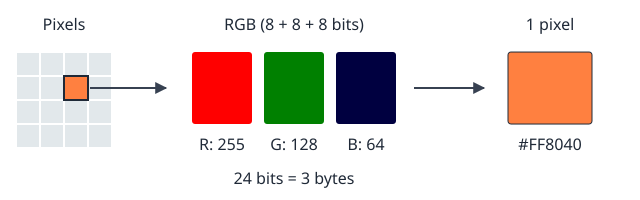
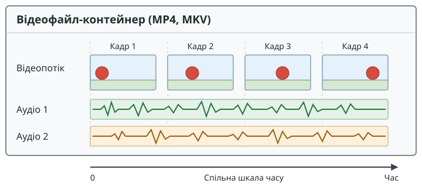

```{=html}
<style>
.reveal {
  color: #233238;
  font-family: "Aptos", "DejaVu Sans", sans-serif;
}
.reveal h1, .reveal h2, .reveal h3 {
  color: #174e67;
  font-family: "Aptos Display", "DejaVu Sans", sans-serif;
  text-transform: none;
}
.reveal h2 {
  border-bottom: 3px solid #e6a23c;
  padding-bottom: .18em;
}
.reveal strong { color: #a64b34; }
.reveal .slide-number { color: #174e67; }
.reveal .small { font-size: .68em; }
.reveal table { font-size: .72em; }
.reveal img { max-height: 480px; object-fit: contain; }
</style>
```

# Біт, байт, кілобайт, ...

## Перший електронний цифровий комп'ютер [^Z1-computer] [^MESM]

[^Z1-computer]: Ще раніше існував електромеханічний комп'ютер [Z1](https://uk.wikipedia.org/wiki/Z1_(комп'ютер)).
[^MESM]: Першу в СРСР електронну обчислювальну машину [МЕСМ](https://uk.wikipedia.org/wiki/МЕСМ) створили в Києві.

<!-- [електронні лампи](https://uk.wikipedia.org/wiki/Електронна_лампа) для зберігання бітів -->

::: {.columns}
::: {.column width="55%"}
"){width=100%}
:::
::: {.column width="45%"}
**Комп'ютер ABC**

| Характеристика | Значення |
| --- | ---: |
| Рік завершення | 1942 |
| [Вакуумні лампи](https://uk.wikipedia.org/wiki/Електронна_лампа) | Понад 300 |
| Частота живлення | 60 Гц |
| Пам'ять | 3 000 біт |
| Маса | 320 кг |
:::
:::

## Комп'ютер працює з двома станами

[off]: https://upload.wikimedia.org/wikipedia/commons/2/26/Bulbgraph_Off.svg
[on]: https://upload.wikimedia.org/wikipedia/commons/1/12/Bulbgraph.svg

| Сигналу немає | Є сигнал |
| :---: | :---: |
| ![Вимкнена лампа][off]{width=72} | ![Увімкнена лампа][on]{width=72} |
| **0** | **1** |

Один такий стан — **біт**.

::: {.columns .fragment}
::: {.column width="50%"}
**10001011**
:::
::: {.column width="50%"}
![on][on]{height=1em} ![off][off]{height=1em} ![off][off]{height=1em} ![off][off]{height=1em} ![on][on]{height=1em} ![off][off]{height=1em} ![on][on]{height=1em} ![on][on]{height=1em}
:::
:::

## Двійкові дані в кіно


## Скільки значень дають біти?

| Кількість бітів | Степінь двійки | Усі стани | Кількість значень |
|----------------:|:-------------:|:----------|------------------:|
| 1 | $2$ | `0`, `1` | 2 |
| 2 | $2 \cdot 2$ | `00`, `01`, `10`, `11` | 4 |
| 3 | $2 \cdot 2 \cdot 2$ | `000`, `001`, `010`, `011`, `100`, `101`, `110`, `111` | 8 |

## Скільки значень дають біти?

$$N = 2^n = \underbrace{2 \cdot 2 \cdots 2}_{n\text{ множників}}$$

- $n$ — кількість бітів.
- $N$ — кількість комбінацій.

## Скільки значень дають біти?

| Кількість бітів | Степінь двійки                   | Скільки різних значень |
|----------------:|:--------------------------------:|-----------------------:|
|               8 | $2^8$                            |                    256 |
|          **10** | **$2^{10}$**                     |               **1024** |
|              16 | $2^{16}$                         |                  65536 |
|              32 | $2^{32}$                         |             4294967296 |
|              64 | $2^{64}$                         |   18446744073709551616 |

## Самоперевірка {background-image="https://news.mit.edu/sites/default/files/styles/news_article__image_gallery/public/images/202505/MIT-FreeAtoms-01-press.jpg" background-opacity="0.18"}

Скількох бітів достатньо, щоб пронумерувати всі атоми у спостережуваному Всесвіті?

::: {.callout-note title="Число Еддінгтона"}
[Число Еддінгтона](https://en.wikipedia.org/wiki/Eddington_number) оцінює кількість протонів у спостережуваному Всесвіті як приблизно $10^{80}$.
Отже, атомів не більше, ніж протонів: кожен атом містить щонайменше один протон.
:::

::: {.callout-tip title="Підказка"}
::: {.incremental}
- скільки бітів потрібно, щоб закодувати 10 значень?
- $2^{10} = 1024 \approx 1000 = 10^3$
:::
:::

## Байт і розміри даних

**8 бітів = 1 байт.**

Байт може мати **256** різних значень.

::: {.fragment}
Для більших обсягів є **кіло**байти, **мега**байти й **гіга**байти. 

::: {.callout-warning title="Запитання"}
Скільки байтів у кілобайті?
:::
:::

## Порядки величин даних: десяткові та двійкові

| Одиниця | Десяткова кількість байтів | SI | Двійкова кількість байтів | JEDEC | МЕК (IEC)[^IEC-prefixes] |
| --- | ---------------------------: |:--:| --------------------------: |:-----:|:---------:|
| байт | $1$ | B | $1$ | B | B |
| кілобайт | $10^3$ | **kB** | $2^{10}$ | **KB** | KiB |
| мегабайт | $10^6$ | MB | $2^{20}$ | MB | MiB |
| гігабайт | $10^9$ | GB | $2^{30}$ | GB | GiB |

- десяткові: $\times 1000 = 10^3$
- двійкові: $\times 1024 = 2^{10}$

[^IEC-prefixes]: Для двійкових кратних МЕК (IEC) використовує префікси «кібі-», «мебі-», «гібі-» тощо.

<!-- У SI kB, MB і GB — десяткові одиниці; у JEDEC KB, MB і GB — двійкові. -->

## Порядки величин даних: експонента

<figure id="fig-orders-of-magnitude" class="figure">
  
  <figcaption class="figure-caption">Об'єкти у різних порядках величини: від субатомних масштабів до спостережуваного Всесвіту.</figcaption>
</figure>

<!-- .png){width=100%} -->


## Самоперевірка

1. Який кілобайт більший: kB чи KB (KiB) — і на скільки байтів?

2. А яка різниця в байтах між десятковими та двійковими терабайтами? Скільки ця різниця становить в GB і GiB?

:::: {.callout-tip title="Підказки" .fragment}
- $2^{10} = 1024$

::: {.fragment .blur }
- $2^{30} = 1073741824$
:::

::::

# 
<!-- # Позиційні системи числення -->

::: {.r-fit-text .text-center}
० १ २ ३ ४ ५ ६ ७ ८ ९
:::
::: {.fragment .r-fit-text .text-center}
⠴ ⠂ ⠆ ⠒ ⠲ ⠢ ⠖ ⠶ ⠦ ⠔
:::
::: {.fragment .r-fit-text .text-center}
〇 一 二 三 四 五 六 七 八 九
:::
::: {.fragment .r-fit-text .text-center}
0 1 2 3 4 5 6 7 8 9
:::
# 

<!-- 
::: {.fragment .r-fit-text .text-center}
Цифри — цеглинки чисел
:::
-->

## Позиційний запис: десятковий

- Цифри (цеглинки чисел): **0**, **1**, ..., **9**
- вага позиції — степінь 10.

$$2026_{10}=2\cdot10^3+0\cdot10^2+2\cdot10^1+6\cdot10^0$$

## Позиційний запис: двійковий

- Цифри: **0** і **1**.
- вага позиції — степінь 2.

$$101_2=1\cdot2^2+0\cdot2^1+1\cdot2^0=5_{10}$$

## Позиційний запис: шістнадцятковий

- Цифри: 

  ::: {.incremental}
  - **0**, ..., **9** (всього 10, 6 бракує)
  - **A**, **B**, **C**, **D**, **E**, **F**
  :::

- вага позиції — степінь 16.

::: {.fragment}
$$2026_{10}=7\cdot16^2+14\cdot16^1+10\cdot16^0=7EA_{16}$$
:::

## Лічба чотирма бітами

Як змінюється запис числа під час додавання одиниці?



## Навіщо потрібна шістнадцяткова система?

Одна hex-цифра відповідає **чотирьом бітам**.

::: {.columns}
::: {.column width="50%"}
| Двійкова група | Hex |
| --- | --- |
| **0000** | **0** |
| **0001** | **1** |
| **0010** | **2** |
| **0011** | **3** |
| **0100** | **4** |
| **0101** | **5** |
| **0110** | **6** |
| **0111** | **7** |
:::
::: {.column width="50%"}
| Двійкова група | Hex |
| --- | --- |
| **1000** | **8** |
| **1001** | **9** |
| **1010** | **A** |
| **1011** | **B** |
| **1100** | **C** |
| **1101** | **D** |
| **1110** | **E** |
| **1111** | **F** |
:::
:::

## Самоперевірка

- Який зараз рік у двійковій системі числення?
- Яке шістнадцяткове число йде після $ABCDEF_{16}$?

::: {.callout-tip title="Підказка" }

::: {.incremental}
- $2026_{10}=7EA_{16}$
- $7_{16}=0111_2$, $A_{16}=1010_2$, $E_{16}=1110_2$
- $\left(\underbrace{0111}_{7_{16}}\,\underbrace{1110}_{E_{16}}\,\underbrace{1010}_{A_{16}}\right)_2$
<!-- - ![off][off]{height=1em}![on][on]{height=1em}![on][on]{height=1em}![on][on]{height=1em}![on][on]{height=1em}![on][on]{height=1em}![on][on]{height=1em}![off][off]{height=1em}![on][on]{height=1em}![off][off]{height=1em}![on][on]{height=1em}![off][off]{height=1em} -->
:::

:::

<!-- Тому $2026_{10}=111111001010_2=7EA_{16}$. -->

## Беззнакові цілі числа

::: {.columns}
::: {.column width="50%"}
**8-бітовий беззнаковий тип**

- $00_{16} \to 0$
- $01_{16} \to 1$
- $0A_{16} \to 10$
- $FF_{16} \to 255 = 2^8-1$
:::
::: {.column width="50%"}
**16-бітовий беззнаковий тип**

- $0000_{16} \to 0$
- $0001_{16} \to 1$
- $000A_{16} \to 10$
- $FFFF_{16} \to 65535 = 2^{16}-1$
:::
:::

## Переповнення: що, якщо бітів замало?

$$
\begin{array}{r}
\mathtt{\phantom{0}\boxed{1000'0000}_2}\\
\underline{+\mathtt{\phantom{0}\boxed{1000'0000}}_2}\\
\mathtt{1'\boxed{0000'0000}_2}
\end{array}
$$

::: {.callout-note title="Рішення: Класи лишків"}
Зберігається остача за модулем $256$. **Класи лишків** визначають **еквівалентні** числа:

$$0 \equiv 256 \equiv 2\cdot256 \equiv \cdots \equiv -256 \equiv -2\cdot256 \equiv \cdots \equiv 256\cdot k \pmod{256}$$
:::

## Самоперевірка

Назвіть приклади еквівалентних чисел для 10 за модулем 256, додатних і від'ємних.

::: {.callout-tip title="Підказка" .fragment}
$$10 \equiv 0 + 10 \equiv 256 + 10 \equiv 256 \cdot k + 10 \pmod{256}$$
:::


## Класи лишків


```{python}
#| label: fig-modular-integers
#| echo: false
#| fig-alt: "Інтерактивне коло класів лишків. Повзунок змінює модуль від 2 до 256 (повний байт), початкове значення — 16."

%run ../scripts/modular_residues.py
from IPython.display import HTML, display

figure = create_modular_residue_figure(repr_min=-2, repr_max=3)

display(HTML(figure.to_html(full_html=False, include_plotlyjs="cdn", include_mathjax=False)))
```

<!-- 
## Класи лишків

::: {.content-visible when-format="html"}

::: 

-->


## Від'ємні числа: доповнення до двійки

У $n$ бітах число $-x$ кодують як $2^n-|x|$.

::: {.callout-important title="Старший біт визначає знак числа"}

- **0** — число невід'ємне.
- **1** — найближче до нуля від'ємне $\equiv \pmod{2^n}$.

:::

::: {.callout-note title="Приклад для 8 бітів"}

$$
-5\equiv 256-5 \equiv 251=11111011_2 \pmod{256}
$$

:::

## Числа на вісі


## Самоперевірка

1. У доповненні до двійки більше додатних чи від'ємних значень? Нуль не рахуємо.
2. Якому числу відповідає $\mathtt{FF}_{16}$ в 8-бітовому доповненні до двійки? А в 16-бітовому доповненні до двійки?

# Текст — теж послідовність чисел

Таблиця кодування пов'язує символи з числами.

- ASCII кодує 128 базових символів.
- Unicode призначає кодові точки символам різних писемностей.
- UTF-8 записує кодові точки одним або кількома байтами.

`A` у UTF-8 — `41`.

`л` у UTF-8 — `D0 BB`.

## Як прочитати файл?

Ті самі байти можна тлумачити як текст, зображення, звук або інструкції.

**Текстовий файл** використовує домовлене кодування символів.

**Бінарний файл** має формат, який інтерпретує відповідна програма.

Наприклад, PNG починається з підпису `PNG`.

## Піксель: одна клітинка зображення

Растрове зображення — це сітка пікселів.

Кожен піксель має колір, який часто задають складовими **R**, **G** і **B**.

{fig-alt="Піксель у сітці задається інтенсивностями червоного, зеленого та синього світла."}

## True Color: 3 байти на піксель

У True Color на кожен канал RGB припадає по 8 бітів.

$$8+8+8=24\text{ біти}=3\text{ байти на піксель}$$

Це дає $256^3=16\,777\,216$ комбінацій кольорів.

Зображення 50 МП без стискання займає близько **150 MB**.

## Відео — кадри, звук і час

Відео — це послідовність зображень, що оновлюється з певною частотою.

Контейнер може об'єднувати відеопотік та одну чи кілька аудіодоріжок.

{fig-alt="Послідовні кадри й дві аудіодоріжки синхронізовано на спільній шкалі часу."}

## Скільки важить хвилина відео?

Без стискання, прозорості й аудіо: 24-бітове RGB, 30 кадрів/с.

- 50 МП на кадр: $50\,000\,000\cdot3\cdot30\cdot60\approx270$ GB.
- Full HD ($1920\times1080$): $1920\cdot1080\cdot3\cdot30\cdot60\approx11.2$ GB.

Стиснення відео зменшує цей обсяг на багато порядків.

## Стиснення: зберегти все чи відкинути частину?

::: {.columns}
::: {.column width="50%"}
**Без втрат**

Вихідні дані відновлюються точно.

Приклади: ZIP, PNG, FLAC.

:::
::: {.column width="50%"}
**З втратами**

Частина малопомітних деталей відкидається.

Приклади: JPEG, MP3, H.264.

:::
:::

## Коротші коди для частіших символів

Кодування Гаффмана використовує частоти символів.

Частішим символам надаються коротші коди, рідкісним — довші.

Префіксні коди дають змогу однозначно відновити текст.

Стисніть текст у [зошиті Гаффмана](https://molab.marimo.io/github/SGo-Go/cs00/blob/main/assets/lecture01/notebooks/huffman_coding.py/wasm).

## Шифрування приховує зміст

Шифрування перетворює відкритий текст на шифротекст за допомогою ключа.

У шифрі Цезаря ключ — це зсув літер в абетці.

Переберіть ключі у [зошиті шифру Цезаря](https://molab.marimo.io/github/SGo-Go/cs00/blob/main/assets/lecture01/notebooks/caesar_cipher.py/wasm).

Це навчальний шифр, не придатний для захисту секретів.

## Чому `0.1 + 0.2` не дорівнює точно `0.3`?

Дробові числа зберігаються у двійковому форматі з обмеженою точністю.

Більшість десяткових дробів не мають скінченного двійкового запису.



```{python}
#| echo: true
print(0.1 + 0.2)
print(0.5 + 0.75)
```

Спробуйте інші значення у [зошиті про рухому кому](https://molab.marimo.io/github/SGo-Go/cs00/blob/main/assets/lecture01/notebooks/floating_point.py/wasm).

## Що спробувати далі?

- [Переглянути байти файлу у hex](https://molab.marimo.io/github/SGo-Go/cs00/blob/main/assets/lecture01/notebooks/hex_viewer.py/wasm).
- [Збільшити пікселі зображення](https://molab.marimo.io/github/SGo-Go/cs00/blob/main/assets/lecture01/notebooks/image_viewer.py/wasm).
- Повернутися до [конспекту лекції](../lectures/01-data-encoding.qmd) для докладних пояснень.
